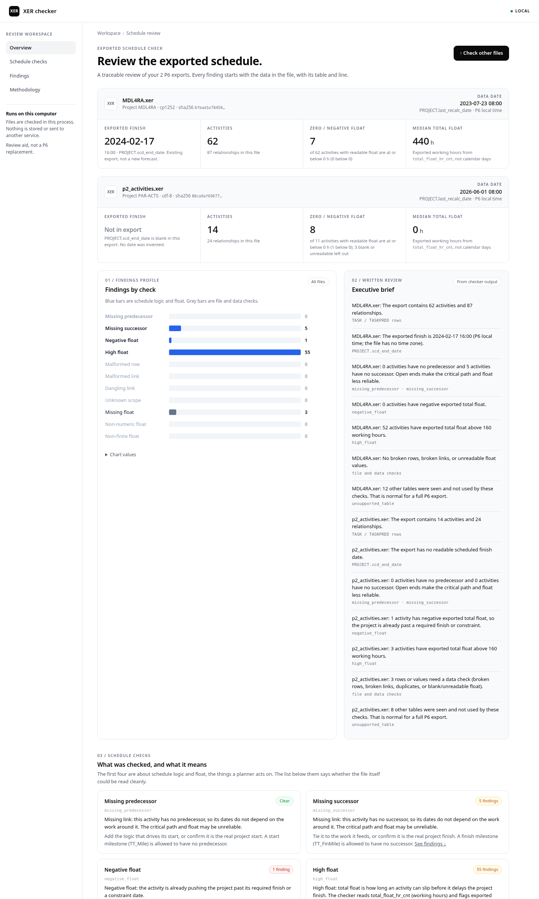

# XER checker

A local checker for Primavera P6 `.xer` schedule files.

You give it an XER export. It reads the text in the file and tells you what looks wrong in the schedule: missing links, negative total float, high total float, and broken rows. Everything runs on your computer. Nothing is sent to another service.

It does not build a new schedule, and it does not recalculate float. The numbers it shows are the ones already stored in the export.

Python 3.10 or newer is enough. There are no third-party packages. These commands were checked on Python 3.12.3. Run them from the repository root.

## Run the local web page

```bash
python3 -m xercheck --serve --host 127.0.0.1 --port 8741
```

Then open [http://127.0.0.1:8741/](http://127.0.0.1:8741/) and choose one or more `.xer` files.

The result page has four sections:

- **Overview** — one panel per file (exported finish, activities, zero/negative float, median total float), a chart that counts the findings, and a short written brief
- **Schedule checks** — each check in plain English, with its count
- **Findings** — every finding with file, table, and line, filterable
- **Methodology** — how the file is read

The default high-float threshold is **160 hours** (about four 40-hour weeks). Change it with `--high-float-hours` or the form field. High float means stored total float **strictly greater** than that number. The unit is hours from `total_float_hr_cnt`, not days.



A short walkthrough of the same two files is in this [Loom video](https://www.loom.com/share/124c198917d648a5ad791cd11f9a9ad5).

## Run from the command line

```bash
python3 -m xercheck fixtures/github/MDL4RA.xer fixtures/github/p2_activities.xer
python3 -m xercheck fixtures/public/P01_CPM.xer fixtures/public/P02_CPM.xer --html report.html
python3 -m xercheck fixtures/synthetic/SYNTHETIC_open_ends.xer --only missing_predecessor
```

Each file must be at most 2,000,000 bytes. One check accepts at most 6 files and 8,000,000 bytes in total. A bad threshold or an unreadable file stops the command. Findings themselves do not change the exit code: `0` means the check ran, `2` means the arguments were rejected, `1` means a file could not be read.

## Run the tests

```bash
python3 -m unittest discover -s tests -v
```

## Sample files

- `fixtures/public/` — two unmodified research schedules from [Primavera P6 Schedules](https://doi.org/10.7294/w4-5r6z-d346) by Diana Franco Duran (University Libraries, Virginia Tech, 2019), licensed [CC BY 3.0 US](https://creativecommons.org/licenses/by/3.0/us/).
- `fixtures/github/MDL4RA.xer` — a five-house building demo exported from Primavera P6, copied from the public [inigmat/exupery](https://github.com/inigmat/exupery) repository (MIT).
- `fixtures/github/p2_activities.xer` — a small synthetic test schedule with negative, high, and blank float, copied from the public [danafitkowski/cpp-critical-path-validator](https://github.com/danafitkowski/cpp-critical-path-validator) repository (MIT). It is a test fixture, not a real project.
- `fixtures/synthetic/` — tiny files written for this project's tests. They are not public schedules.

Names, hashes, links, and full attribution are in [`SOURCES.md`](SOURCES.md). How the checks work is in [`EXPLAIN.md`](EXPLAIN.md).

## License

The checker itself is [MIT](LICENSE), Copyright (c) 2026 Vedran Marčetić. The sample XER files keep the licences of their original sources, as described in `SOURCES.md`.
